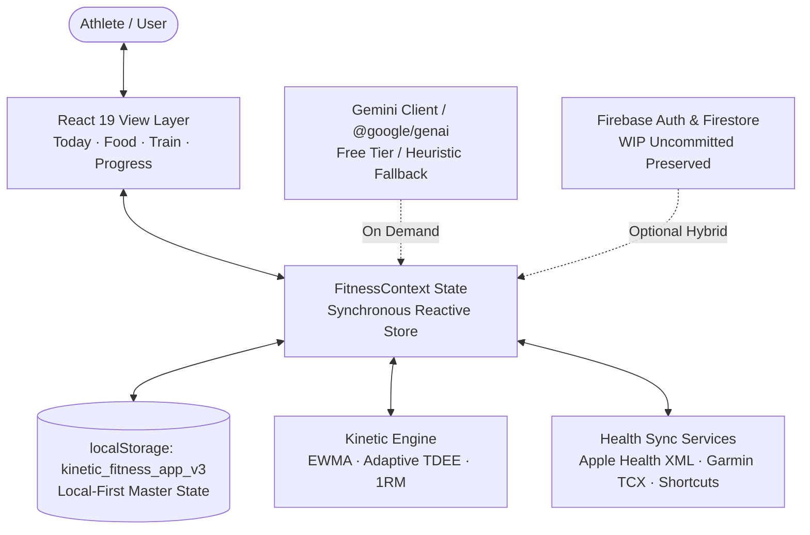

# AGENTS.md — Agentic Engineering Specification

Welcome, Agent. This file is the operational manual and architecture contract for autonomous coding agents (e.g. Google Antigravity, Claude Code, Cursor Composer, Devin) operating on the **Kinetic** codebase.

---

## 1. Project Topology & Architecture Identity

**Kinetic** is an athletic-grade, local-first fitness, nutrition, and resistance training application built with **React 19**, **TypeScript**, **Vite 8**, and **Tailwind CSS v4**.



### 1.1 Source Code Directory Map
- `src/types.ts`: Central TypeScript schema definitions for entire application state.
- `src/context/FitnessContext.tsx`: Local-first reactive state management store.
- `src/utils/engine.ts`: Mathematical algorithms (EWMA smoothing, adaptive TDEE, 1RM Epley, pace calculations).
- `src/utils/parseNutrition.ts`: Locale-resilient international numerical parsing.
- `src/utils/workoutSession.ts`: Active workout persistence and timestamp-based rest clocks.
- `src/services/aiFoodEstimation.ts`: Gemini 2.5 Flash meal estimator with zero-cost offline heuristic fallback.
- `src/services/quickLogParser.ts`: Multi-intent natural language command-line parser.
- `src/services/routineGenerator.ts`: Workout draftsman strictly constrained to local Atlas library.
- `src/services/narrativeCoach.ts`: Weekly athletic coach storytelling and confidence diagnosis.
- `src/services/healthSync.ts`: Ingestion parsers for Apple Health XML, Garmin TCX, CSV, and iOS Shortcuts.
- `src/components/common/TrendChart.tsx`: Token-based accessible SVG chart component with crosshair tooltips.
- `src/components/today/TodayView.tsx`: Daily dashboard, quick-log bar, macro rings, hydration tracker.
- `src/components/food/AddFoodModal.tsx`: Itemized meal logger, AI estimator, and custom food creator.
- `src/components/train/ProgramBuilderModal.tsx`: Routine builder and AI draftsman.
- `src/components/progress/WeeklyReviewModal.tsx`: Weekly metabolic check-in and interactive target calibration.

---

## 2. Inviolable Operational Invariants

Any agent operating on this repository must strictly adhere to the following 8 core invariants:

### INVARIANT 1: Zero Cost Guarantee ($0 Forever)
- **Rule**: Never introduce features or API calls that require paid tokens, credit card billing, or paid subscriptions for the developer, owner, or user.
- **Implementation**:
  - Always use Google AI Studio Free Tier models (e.g. `gemini-2.5-flash`).
  - Always provide an instant, 100% offline, deterministic heuristic fallback.
  - If no API key is configured, the application must run silently and fully offline at zero cost.

### INVARIANT 2: Local-First Supremacy
- **Rule**: Core functionality (nutrition logging, workout tracking, rest timers, adaptive TDEE, habits, reflections) must operate with zero network access and no mandatory account sign-up.
- **Storage Target**: Primary state must cleanly serialize and restore from `localStorage: eunoia_os_v1` (with seamless migration from `kinetic_fitness_app_v3`).

### INVARIANT 3: Preserve Firebase WIP
- **Rule**: The working directory contains uncommitted Firebase Auth & Firestore WIP files (`firebase.json`, `firestore.rules`, `src/services/firebase.ts`, `src/context/AuthContext.tsx`, `src/components/auth/`).
- **Constraint**: Do NOT overwrite, discard, or stage these files in local-first commits unless the task explicitly commands a Cloud Sync deployment.

### INVARIANT 4: Human-in-the-Loop AI
- **Rule**: AI-generated content (parsed food items, routine prescriptions, quick-log actions) must NEVER commit silently to user state without explicit user review and confirmation in the UI. Output must populate editable preview forms.

### INVARIANT 5: Resilient Numerical & Locale Parsing
- **Rule**: All numeric inputs must handle international decimal formatting (e.g., Brazilian `1,5` vs English `1.5`) via `src/utils/parseNutrition.ts`. Guard against `NaN`, infinite, negative, or absurd values ($>5000\text{ kcal}$, $>350\text{ kg}$).

### INVARIANT 6: Zero Regression Policy
- **Rule**: No code change is complete without green tests, zero type errors, and a successful production build.
  - Test Suite: `npx tsx --test $(find src -name '*.test.ts')`
  - Typecheck: `npm run lint` (`tsc --noEmit`)
  - Production Build: `npm run build` (`vite build`)

### INVARIANT 7: Atomic Commits & Instant Remote Pushes
- **Rule**: ALWAYS execute atomic git commits and push immediately to remote (`origin/main`).
- **Standard**:
  - Break work into distinct, self-contained atomic units (e.g., schema migration, feature component, database expansion, documentation).
  - Every atomic commit MUST pass tests, typecheck, and build before committing.
  - IMMEDIATELY push every commit to `origin/main` (`git push origin main`). Never accumulate unpushed local commits or delay pushes until the end of a session.
  - Write descriptive semantic commit messages: `feat(domain): ...`, `fix(domain): ...`, `docs: ...`, `refactor(domain): ...`.

### INVARIANT 8: User Data Permanence & Non-Destructive Migrations
- **Rule**: Application updates must NEVER wipe, reset, or degrade existing user data in `localStorage` or cloud storage.
- **Migration Contract**:
  - When new default options (e.g. food library items, exercise definitions, starter templates) are added, the storage hydration logic MUST non-destructively merge the new system defaults into the user's existing library.
  - Existing user custom foods, custom exercises, custom habits, logged entries, and weigh-ins must be strictly preserved.
  - Upgrades from legacy storage keys (e.g., `kinetic_fitness_app_v3` -> `eunoia_os_v1`) must automatically migrate all records on first boot without requiring manual user action or data loss.

---

## 3. The Agentic Execution Protocol

When executing a user request, agents must follow this 5-stage loop:

```
[1. Survey] ──> [2. Plan] ──> [3. Implement] ──> [4. Verify] ──> [5. Commit & Push]
     │               │               │                │                 │
 Read target     Formulate       Minimal diffs    All 67+ tests     Granular git
 files & tests   architecture    matching tokens  Lint & Vite build commits to origin
```

1. **Survey**:
   - Inspect existing interfaces in `src/types.ts`.
   - Read test suites associated with the domain to learn established verification patterns.
2. **Plan**:
   - Verify that the plan honors all 8 Inviolable Invariants (including atomic commits and data permanence).
   - Design schemas before writing UI components.
3. **Implement**:
   - Write clean, modular TypeScript code.
   - Bind visual elements to design tokens (`var(--color-accent)`, `var(--color-surface)`, `var(--color-text)`, etc.).
4. **Verify**:
   - Run tests: `npx tsx --test $(find src -name '*.test.ts')`.
   - Run typecheck: `npm run lint`.
   - Run build: `npm run build`.
5. **Commit & Push (Atomic & Instant)**:
   - Make an atomic commit for each logical unit of work as soon as it passes verification.
   - Stage files selectively using `git add <explicit files>`. Do NOT stage unrelated WIP files.
   - Create semantic commits: `feat(domain): description`, `fix(domain): description`, `test(domain): description`, `docs: description`.
   - Immediately execute `git push origin main`. Never leave commits stranded locally.

---

## 4. Subagent Topologies & Roles

When decomposing large features or utilizing subagent swarms (`invoke_subagent`), structure responsibilities as follows:

```
                          ┌───────────────────────┐
                          │   Orchestrator Agent  │
                          └──────────┬────────────┘
                                     │
         ┌───────────────────────────┼───────────────────────────┐
         │                           │                           │
         ▼                           ▼                           ▼
┌──────────────────┐       ┌──────────────────┐       ┌──────────────────┐
│ Core Logic Agent │       │ UI/Design Agent  │       │ Eval/Test Agent  │
│ Engine / Schemas │       │ Tailwind / Views │       │ Golden Set / CI  │
└──────────────────┘       └──────────────────┘       └──────────────────┘
```

1. **Core Logic Agent**:
   - Focus: Mathematical models, state transitions in `FitnessContext`, service parsers.
   - Primary files: `src/utils/engine.ts`, `src/types.ts`, `src/context/FitnessContext.tsx`, `src/services/`.
2. **UI & Design System Agent**:
   - Focus: View components, token consistency, micro-interactions, modal focus traps, accessibility (`role="img"`, `aria-label`).
   - Primary files: `src/components/`, `src/index.css`.
3. **Evaluation & Safety Agent**:
   - Focus: Expanding `aiEvaluationHarness.test.ts`, asserting physiological bounds, testing adversarial and locale inputs.
   - Primary files: `src/services/*.test.ts`, `src/utils/*.test.ts`.
4. **Cloud / Dual-Sync Agent** *(Specialized)*:
   - Focus: Hardening Firestore rules, testing App Check, managing Firebase Auth state synchronization while preserving offline speed.
   - Primary files: `firestore.rules`, `firebase.json`, `src/services/firebase.ts`.

---

## 5. Debugging & Error Recovery Playbook

| Symptom | Diagnostic Step | Remediating Action |
| :--- | :--- | :--- |
| **`TypeScript error: TS6234 get accessor`** | Check `@google/genai` response methods. | `response.text` is a getter property, not a function. Do not invoke as `response.text()`. |
| **`Weights/foods filter is not a function`** | Check mock helper arguments. | `buildInitialWeeklyReview(weights, loggedFoods, profile)` takes 3 arguments. |
| **`CardioSession property error`** | Check `src/types.ts` cardio definition. | Use lowercase `'running' \| 'cycling' \| 'walking'` and `caloriesBurned: number`. |
| **Interactive command prompt hangs** | A command prompted for interactive `y/n`. | Cancel via `manage_task(Action='kill')` and run with non-interactive flags (e.g. `npx tsx --test`). |
| **Accidental git staging of Firebase WIP** | Check `git status`. | Use `git reset <file>` to unstage Firebase WIP files immediately before committing. |
