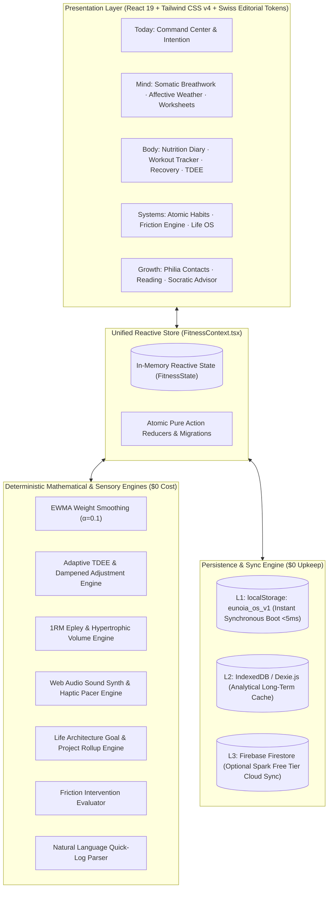
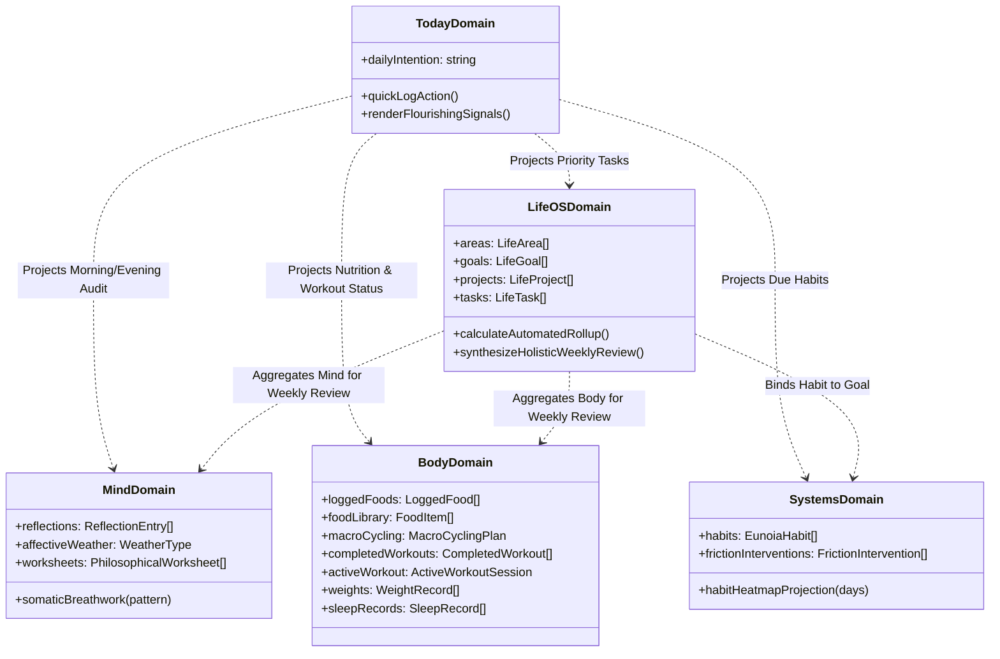
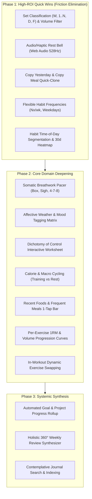

# EUNOIA — System Architecture & Design Specification (HLD & LLD)

> **Document Version**: 3.0.0 (Post-Competitive Gap Transformation)  
> **Target Audience**: Senior, Mid-Senior, and Junior Agentic Engineers  
> **Core Mandate**: $0 Lifetime Cost • Local-First Modular Monolith • Token-Budget Stewardship • Stoic Editorial Elegance

---

## 1. High-Level Design (HLD)

### 1.1 Architectural Philosophy: The Token-Efficient Modular Monolith
Eunoia is an athletic-grade personal operating system and human flourishing platform grounded in classical Stoicism, Aristotelian Eudaimonia, Epicureanism, and modern behavioral physiology.

Following an exhaustive competitive review against market leaders (*Stoic*, *MacroFactor*, *Hevy*, *Everyday*, and *Notion Life OS*), Eunoia maintains four inviolable architectural pillars:
1. **The Modular Monolith as an Invariant**: Distributed microservices introduce catastrophic context bloat (Docker configs, RPC boilerplate, network mocks, multi-repo synchronization), rapidly degrading autonomous agent reasoning. A cohesive modular monolith allows autonomous agents to reason globally with maximum token efficiency while eliminating all inter-process latency and serialization overhead.
2. **Strict $0 Cost Guarantee**: No external paid APIs, no recurring database bills, no serverless meters. All computations (adaptive TDEE, EWMA weight smoothing, 1RM Epley curves, rest bells, breathwork pacers, habit projections) are executed via **deterministic client-side algorithms** and standard Web APIs (`Web Audio API`, `Notification API`, `Navigator.vibrate`, `Service Workers`). Public food databases (TACO, USDA SR-Legacy, OpenFoodFacts) are stored locally or fetched on-demand.
3. **Local-First Privacy Supremacy**: User data lives on the client in `localStorage` (`eunoia_os_v1`) as the primary L1 cache, with non-destructive fallback migrations. Cloud synchronization (Firebase Firestore Spark Free Tier) is optional, zero-cost, and non-blocking.
4. **Calm Stoic Aesthetics**: In contrast to commercial competitors that employ abrasive gamification, cartoon badges, and dopamine loops, Eunoia adheres to Swiss editorial typography, generous negative space, subtle tactile feedback, and monochromatic discipline.



---

### 1.2 Domain Boundaries & Boundary Contracts
The modular monolith is partitioned into 5 core domains, plus the unifying Today command projection:



| Domain | Key Entities | Core Responsibilities | Cross-Domain Interaction Contract |
| :--- | :--- | :--- | :--- |
| **Mind & Contemplation** | `ReflectionEntry`, `AffectiveWeather`, `PhilosophicalWorksheet`, `BreathworkPattern` | Somatic nervous system grounding, emotional check-in, structured Stoic inquiry (Dichotomy of Control), chronological journal indexing. | Feeds emotional state & mindfulness frequency into the Life OS Weekly Review. Supplies Today view with daily intention. |
| **Nutrition & Energy** | `LoggedFood`, `FoodItem`, `MacroGoals`, `MacroCyclingPlan`, `SavedMeal` | Dynamic calorie/macro cycling (training vs rest), 1-tap quick logging (Recent Foods/Frequent Meals), copy yesterday/meal, fiber & sodium monitoring. | Receives training day schedule from Training domain to trigger calorie/macro cycling targets automatically. Feeds caloric trend to TDEE engine. |
| **Training & Athletics** | `CompletedWorkout`, `ActiveWorkoutSession`, `ExerciseDefinition`, `ExerciseSet` (`W`/`1..N`/`D`/`F`) | 4-tier set classification, hypertrophic volume calculation, per-exercise 1RM/volume history, Web Audio/haptic rest chime, live exercise swapping. | Signals workout completion to Nutrition (for training-day macro switch) and Today view. Feeds athletic volume and 1RMs to Weekly Review. |
| **Systems & Habits** | `EunoiaHabit`, `FrictionIntervention`, `HabitFrequency` | Flexible scheduling (Nx/week, weekdays, day masks), 30-90 day consistency dot-matrix heatmap, time-of-day segmentation, behavioral friction engineering. | Binds habits to parent LifeGoals. Projects daily pending actions to Today view grouped by time of day. Feeds compliance rates to Weekly Review. |
| **Life Architecture** | `LifeGoal`, `LifeProject`, `LifeTask`, `WeeklyReviewRecord` | Hierarchy of flourishing (Areas $\rightarrow$ Goals $\rightarrow$ Projects $\rightarrow$ Tasks), automated progress rollup, holistic 360° weekly review synthesis, quick capture inbox. | Consumes metrics from Mind, Body, and Systems to synthesize the holistic retrospective without data fragmentation. |

---

### 1.3 Database Architecture: Hybrid NoSQL + Relational Aggregations

| Criterion | NoSQL (Current L1 `localStorage` + L2 Firestore) | In-Browser SQLite WASM | Architectural Decision for Eunoia |
| :--- | :--- | :--- | :--- |
| **Storage Engine** | Synchronous browser `localStorage: eunoia_os_v1` | OPFS / IndexedDB SQLite WASM | **Hybrid Pragmatic Architecture**: |
| **Query Speed** | Instant ($<5\text{ms}$ boot). In-memory JavaScript filtering. | $50\text{--}150\text{ms}$ cold boot initialization. | **Operational State (L1)**: Keep NoSQL document tree for instant mobile responsiveness and schema agility. |
| **Schema Evolution** | Non-destructive merging via `mergeLibraries` and optional TypeScript properties. Zero database migration downtime. | Requires strict SQL DDL migrations (`ALTER TABLE`). Can break offline state if migration fails. | **Schema Agility**: NoSQL prevents bricked local storage during agentic feature releases. |
| **Relational Queries** | Computed in-memory selectors (e.g. goal completion rollups, 1RM curves). | Native declarative SQL joins. | **Computed Selectors**: In-memory memoized selectors handle $<100{,}000$ items in $<2\text{ms}$ with zero SQLite dependency overhead. |
| **Financial Cost** | **$0** (Free browser storage + free Spark tier). | **$0** (Local WASM file). | Zero cost invariant fully respected. |

---

### 1.4 Microservices Migration Trigger Criteria
All features **must remain inside the modular monolith**. Extraction into standalone external services is forbidden unless one of the following criteria is met:
1. **GPU-Bound Client Freezing**: Computer vision food recognition or local on-device Whisper models exceed 100MB heap or cannot run in a Web Worker without dropping frames below 60fps.
2. **Multi-Tenant Collaborative Sync**: Transitioning from a single-user OS to real-time multi-user team editing requiring operational transformation (CRDT/WebSockets).
3. **Native OS Daemon Integration**: Continuous background Bluetooth telemetry from wearable hardware that cannot run inside the browser Service Worker.

---

## 2. Comprehensive Domain Design Deep Dives

### 2.1 Domain 1: Mind & Contemplation (Benchmark: Stoic & Rosebud)

#### 2.1.1 Somatic Breathwork Pacer Engine
- **Objective**: Ground the nervous system before morning premeditation or evening reflection via secular somatic breathing.
- **Breathwork Patterns**:
  - `Box Breathing`: Inhale (4s) $\rightarrow$ Hold (4s) $\rightarrow$ Exhale (4s) $\rightarrow$ Hold (4s) — *Parasympathetic stabilization*.
  - `Physiological Sigh`: Deep Inhale (3s) $\rightarrow$ Secondary Inhale Top-up (1s) $\rightarrow$ Extended Exhale (6s) — *Rapid acute autonomic stress release*.
  - `4-7-8 Relaxing Breath`: Inhale (4s) $\rightarrow$ Hold (7s) $\rightarrow$ Exhale (8s) — *Pre-sleep wind-down*.
- **Web Audio & Haptic Implementation ($0 Cost)**:
  - Generates organic harmonic tone via Web Audio API `OscillatorNode` (Sine 432Hz with soft exponential envelope gain ramp).
  - Triggers tactile haptic feedback via `navigator.vibrate([40])` on phase inflection points (e.g. inhale transition, hold, exhale).

#### 2.1.2 Affective Weather & Mood Matrix
- **Affective Weather Continuum**:
  - `radiant` (☀️ High energy, serene, elevated clarity)
  - `clear` (🌤️ Balanced, grounded, stable)
  - `overcast` (⛅ Low energy, mild inertia, neutral)
  - `turbulent` (🌧️ Anxious, scattered, high friction)
  - `stormy` (⛈️ Acute distress, overwhelmed, critical fatigue)
- **Affective Context Tags**: `['sleep', 'body', 'deep_work', 'solitude', 'social', 'clarity', 'friction']`.
- **Contemplative Journal Search**: Instant client-side text filtering across prompt answers, tags, and date ranges.

#### 2.1.3 Guided Philosophical Worksheets
- **Dichotomy of Control Canvas (Epictetus)**:
  - Interactive two-column board: *Within My Absolute Control* (Beliefs, desires, personal effort) vs. *Outside My Absolute Control* (Other people's actions, outcomes, weather, market conditions).
  - Prescribed *Actionable Pivot*: Concrete action statement focusing 100% of energy on the internal circle of control.
- **Premeditatio Malorum (Seneca)**:
  - Visualizing the anticipated obstacle $\rightarrow$ Defining preventative mitigations $\rightarrow$ Internalizing psychological acceptance of worst-case scenarios.

---

### 2.2 Domain 2: Nutrition & Metabolism (Benchmark: MacroFactor & Cronometer)

#### 2.2.1 Calorie & Macro Cycling Engine
- **Athlete Use Case**: Caloric intake fluctuates between heavy training days and recovery rest days while maintaining the exact weekly target.
- **Mathematical Specification**:
  Let $T$ be the number of training days in the weekly schedule, and $R = 7 - T$ be rest days.
  Let $C_{\text{weekly}} = 7 \times \bar{C}_{\text{daily}}$ be the total weekly caloric budget prescribed by the adaptive TDEE engine.
  Given user-specified training day calorie surplus $\Delta C_{\text{train}}$:
  $$C_{\text{training}} = \bar{C}_{\text{daily}} + \Delta C_{\text{train}}$$
  $$C_{\text{rest}} = \frac{C_{\text{weekly}} - (T \times C_{\text{training}})}{R}$$
  - Protein intake is maintained high across both days ($\ge 2.0\text{g/kg}$).
  - Carbs are cycled upward on training days to maximize glycogen replenishment; fats are shifted upward on rest days.
  - Automatically activates the day's macro target based on the user's `weeklySchedule` day classification (`training` vs `rest`).

#### 2.2.2 Frictionless Logging Mechanics ("1-Tap Quick Add")
- **Recent Foods Ring Buffer**: Top 15 most recently logged unique food items automatically cached for instant 1-tap logging without text search.
- **Frequent Meals Catalog**: Top 10 recurring items or composite meals grouped by meal type (`breakfast`, `lunch`, `dinner`, `snack`).
- **Meal Duplication & Day Cloning**:
  - `Copy Yesterday`: 1-tap button copying all logged items from the previous calendar day into today.
  - `Copy Meal`: 1-tap cloning of a specific past meal (e.g. yesterday's lunch) into the current active meal slot.

#### 2.2.3 Core Micronutrient Architecture (Fiber & Sodium)
- **Dietary Fiber (`fiberGrams`)**:
  - Baseline daily target: $14\text{g}$ per $1,000\text{ kcal}$ consumed (clamped to $[25\text{g}, 60\text{g}]$).
  - Displayed as a progress indicator alongside macronutrients to support satiety and gut health.
- **Sodium (`sodiumMg`)**:
  - Tracked for athletic hydration and fluid balance (target: $2,000\text{--}3,500\text{mg}$ for hard-training athletes).
  - Added to `FoodItem` schema with non-destructive fallback to `0` for legacy items.

---

### 2.3 Domain 3: Resistance Training (Benchmark: Hevy & RP Hypertrophy)

#### 2.3.1 4-Tier Set Classification & Hypertrophic Volume Filtering
- **Set Types**:
  - `W` (**Warmup**): Acclimatization sets, ramp-up sets, movement prep.
  - `1..N` (**Normal / Working**): Standard working hypertrophy/strength sets ($RPE \ge 7$).
  - `D` (**Drop Set**): Extended sets performed immediately following a working set at reduced load.
  - `F` (**Failure**): Sets taken to absolute concentric technical failure ($RPE = 10$).
- **Volume Calculation Invariant**:
  $$\text{Hypertrophic Volume} = \sum_{s \in \text{CompletedSets}} (\text{Weight}_s \times \text{Reps}_s) \quad \text{where } s.\text{setType} \in \{\text{'normal'}, \text{'dropset'}, \text{'failure'}\}$$
  Warmup sets (`W`) are strictly **excluded** from total hypertrophic volume metrics, preventing volume distortion.

#### 2.3.2 Per-Exercise 1RM & Volume Progression Curves
- **Historical Query Engine**:
  - Aggregates all sessions containing `exerciseId` across chronological history.
  - Computes top weight, estimated 1RM via Epley formula ($\text{Weight} \times (1 + \frac{\text{Reps}}{30})$ for $\text{Reps} \le 10$), and total working volume per workout.
  - Renders a lightweight, high-performance SVG progress trend line directly within the Exercise Detail modal.

#### 2.3.3 Sensory Rest Bell via Web Audio API & Web Haptics ($0 Cost)
- **Zero Asset Dependency**: No MP3/WAV files required.
- **Tibetan Singing Bowl Chime**:
  - Created using Web Audio API dual oscillator synthesis (Fundamental: 528Hz Love/Repair frequency, Second Harmonic: 1056Hz with detuning).
  - Exponential decay gain envelope mimicking a hammered bronze singing bowl ($2.8\text{s}$ gentle decay).
- **Haptic Rest Alert**:
  - Triggers `navigator.vibrate([120, 80, 120])` when rest timer reaches `00:00`.

#### 2.3.4 Live In-Workout Exercise Swapping
- **Gym Real-World Dynamic**: Target machine is occupied or barbell rack is unavailable.
- **Swapping Protocol**:
  - User taps "Swap Exercise" on an active workout card.
  - Exercise Atlas filters to biomechanically equivalent alternatives (matching `muscleGroup` and similar movement pattern).
  - Swapping replaces the exercise ID and name while preserving any completed sets and pre-populating target sets.

---

### 2.4 Domain 4: Behavioral Systems & Habits (Benchmark: Everyday & Atomic Habits)

#### 2.4.1 Flexible Frequency Scheduling Engine
- **Habit Frequency Types**:
  - `'daily'`: Target every calendar day.
  - `'weekdays'`: Target Monday through Friday ($1 \le \text{DayOfWeek} \le 5$).
  - `'weekends'`: Target Saturday and Sunday ($\text{DayOfWeek} \in \{0, 6\}$).
  - `'weekly_target'`: Target $N$ arbitrary days per rolling week (e.g., 3x/week for resistance training).
  - `'specific_days'`: Array of explicit target days (e.g. $[1, 3, 5]$ for Mon/Wed/Fri).
- **Today Scheduling Evaluation**:
  - Habits that are not scheduled for today are clearly distinguished from missed habits, preventing false completion anxiety.

#### 2.4.2 30-to-90 Day Consistency Heatmap (Dot Matrix)
- **Monochromatic Dot Matrix**:
  - Displays a clean, tactile grid of calendar days (30, 60, or 90 days).
  - Visual states:
    - Filled Obsidian dot: Completed successfully.
    - Hollow circle: Scheduled but not completed (or pending today).
    - Muted dash: Off-day / Not scheduled by frequency rule.
- Eliminates the binary "broken streak" cliff; displays continuous percentage adherence.

#### 2.4.3 Contextual Time-of-Day Segmentation
- Habits are organized into 4 tactile quadrants:
  - 🌅 **Morning Routine** (e.g. hydration, breathwork, morning premeditation).
  - ☀️ **Daytime Flow** (e.g. deep work block, athletic training, walk).
  - 🌙 **Evening Wind-down** (e.g. review, digital friction, reading).
  - ♾️ **Anytime** (e.g. posture check, philia connection).

---

### 2.5 Domain 5: Life Architecture & Holistic Progress (Benchmark: Notion Life OS)

#### 2.5.1 Automated Hierarchical Progress Rollups
- **Flourishing Hierarchy**: $\text{Areas} \rightarrow \text{Goals} \rightarrow \text{Projects} \rightarrow \text{Tasks}$.
- **Mathematical Rollup Specification**:
  - **Project Completion %**:
    $$\text{ProjectProgress} = \begin{cases} 
    100\% & \text{if status is 'completed'} \\ 
    \frac{\sum_{t \in \text{Tasks}} \mathbb{I}(t.\text{isCompleted})}{\text{TotalTasks}} \times 100 & \text{if TotalTasks} > 0 \\ 
    0\% & \text{otherwise} 
    \end{cases}$$
  - **Goal Progress %**:
    $$\text{GoalProgress} = \begin{cases}
    \frac{\text{metricCurrent}}{\text{metricTarget}} \times 100 & \text{if metric defined} \\
    \frac{\sum_{p \in \text{Projects}} \text{ProjectProgress}_p}{\text{TotalProjects}} & \text{if TotalProjects} > 0 \\
    0\% & \text{otherwise}
    \end{cases}$$

#### 2.5.2 Integrated Holistic Weekly Review Synthesizer
The Weekly Review transcends isolated caloric math into a complete 360° retrospective of flourishing:
1. **Mind Retrospective**:
   - Total reflection entries completed.
   - Affective weather distribution (e.g. 5 days Clear, 2 days Overcast).
   - Key insights noted during audits.
2. **Body Retrospective**:
   - Resistance workouts completed vs target schedule.
   - Total hypertrophic volume ($kg$).
   - EWMA trend weight delta and adaptive TDEE recalculation.
3. **Systems Retrospective**:
   - Overall habit compliance rate across all active frequencies.
   - Active friction interventions evaluated for efficacy.
4. **Growth Retrospective**:
   - Philia relationships touched vs overdue contact cadences.
   - Intellectual pages/chapters completed in Reading List.

---

## 3. Database Schema Evolution (`src/types.ts`)

All schema evolutions are strictly **backward-compatible** using optional TypeScript properties (`?`) and default fallbacks during local storage hydration.

```typescript
// =========================================================================
// SCHEMA EVOLUTION DELTA FOR src/types.ts
// =========================================================================

// 1. Mind & Contemplation Extensions
export type AffectiveWeather = 'radiant' | 'clear' | 'overcast' | 'turbulent' | 'stormy';
export type AffectiveTag = 'sleep' | 'body' | 'deep_work' | 'solitude' | 'social' | 'clarity' | 'friction';

export type BreathworkPatternType = 'box' | 'physiological_sigh' | 'relax_478';

export interface BreathworkPhase {
  name: 'Inhale' | 'Hold' | 'Exhale' | 'Hold (Empty)';
  durationSeconds: number;
}

export interface DichotomyOfControlData {
  withinControl: string[];
  outsideControl: string[];
  actionablePivot: string;
}

export interface PremeditatioMalorumData {
  anticipatedObstacle: string;
  preventativeAction: string;
  internalAcceptance: string;
}

export interface ReflectionEntry {
  id: string;
  date: string; // YYYY-MM-DD
  type: ReflectionType;
  promptAnswers: Record<string, string>;
  freeformContent?: string;
  emotionalState?: EmotionalState;
  affectiveWeather?: AffectiveWeather;
  affectiveTags?: AffectiveTag[];
  worksheetType?: 'dichotomy_of_control' | 'premeditatio_malorum' | 'view_from_above';
  dichotomyData?: DichotomyOfControlData;
  premeditatioData?: PremeditatioMalorumData;
  createdAt: string;
}

// 2. Nutrition & Energy Extensions
export interface MacroCyclingPlan {
  enabled: boolean;
  trainingDays: {
    calories: number;
    proteinGrams: number;
    carbsGrams: number;
    fatGrams: number;
  };
  restDays: {
    calories: number;
    proteinGrams: number;
    carbsGrams: number;
    fatGrams: number;
  };
}

export interface MacroGoals {
  calories: number;
  proteinGrams: number;
  carbsGrams: number;
  fatGrams: number;
  waterMl: number;
  fiberGrams?: number;
  sodiumMg?: number;
  cyclingPlan?: MacroCyclingPlan;
}

export interface FoodItem {
  id: string;
  name: string;
  brand?: string;
  category?: 'Protein' | 'Carbohydrates' | 'Fats' | 'Produce' | 'Dairy' | 'Meals';
  servingSize: number;
  servingUnit: string;
  calories: number;
  protein: number;
  carbs: number;
  fat: number;
  fiber?: number;
  sodiumMg?: number; // Core micronutrient tracking
  source?: string;
  barcode?: string;
  isFavorite?: boolean;
  isRecent?: boolean;
  recipeIngredients?: RecipeIngredient[];
}

export interface LoggedFood {
  id: string;
  foodId: string;
  mealType: MealType;
  name: string;
  servingCount: number;
  servingSize: number;
  servingUnit: string;
  calories: number;
  protein: number;
  carbs: number;
  fat: number;
  fiber?: number;
  sodiumMg?: number;
  loggedAt: string; // ISO date string
}

export interface SavedMeal {
  id: string;
  name: string;
  mealType: MealType;
  items: Array<{
    foodId: string;
    servingCount: number;
  }>;
  totalCalories: number;
  totalProtein: number;
}

// 3. Training & Athletics Extensions
export type SetType = 'normal' | 'warmup' | 'dropset' | 'failure';

export interface ExerciseSet {
  id: string;
  setNumber: number;
  targetWeightKg: number;
  targetReps: number;
  actualWeightKg: number;
  actualReps: number;
  isCompleted: boolean;
  rpe?: number;
  setType?: SetType; // Default is 'normal'
}

export interface ExerciseProgressionPoint {
  date: string;
  workoutId: string;
  topWeightKg: number;
  topReps: number;
  estimated1RMKg: number;
  workingVolumeKg: number; // Volume of working sets only
}

// 4. Systems & Habits Extensions
export type HabitFrequency = 'daily' | 'weekdays' | 'weekends' | 'weekly_target' | 'specific_days';

export interface EunoiaHabit {
  id: string;
  title: string;
  purpose: string;
  area: LifeArea;
  frequency: HabitFrequency;
  targetDaysPerWeek?: number;
  targetDaysOfWeek?: number[]; // [0 = Sun, 1 = Mon, ..., 6 = Sat]
  triggerCue: string;
  minimumViableAction: string;
  timeOfDay: 'morning' | 'afternoon' | 'evening' | 'anytime';
  isNonNegotiable: boolean;
  relatedGoalId?: string;
  completedDates: string[]; // YYYY-MM-DD
  archived?: boolean;
  createdAt: string;
}

// 5. Life Architecture & Progress Extensions
export interface LifeProject {
  id: string;
  goalId?: string;
  area: LifeArea;
  title: string;
  description?: string;
  status: 'not_started' | 'in_progress' | 'completed' | 'on_hold';
  priority: 'low' | 'medium' | 'high';
  dueDate?: string;
  progressPercentage?: number; // Auto-calculated from child tasks
  createdAt: string;
}

export interface LifeGoal {
  id: string;
  area: LifeArea;
  title: string;
  description?: string;
  targetDate?: string;
  status: 'active' | 'achieved' | 'paused';
  metricTarget?: number;
  metricCurrent?: number;
  metricUnit?: string;
  progressPercentage?: number; // Auto-calculated from projects & tasks
  createdAt: string;
}

export interface HolisticWeeklyReviewData {
  mind: {
    reflectionsCount: number;
    dominantWeather: AffectiveWeather | 'unrecorded';
    clarityScore?: number;
  };
  body: {
    workoutsCompleted: number;
    hypertrophicVolumeKg: number;
    avgWeightTrendKg: number;
    weightDeltaKg: number;
    estimatedTdee: number;
    proposedCalorieTarget: number;
  };
  systems: {
    habitCompliancePct: number;
    activeHabitsCount: number;
    frictionInterventionsReviewed: number;
  };
  growth: {
    philiaContactsCount: number;
    learningProgressSummary?: string;
  };
}

export interface WeeklyReviewRecord {
  id: string;
  weekEndDate: string;
  avgCalorieIntake: number;
  avgProteinIntake: number;
  avgWeightTrendKg: number;
  weightDeltaKg: number;
  estimatedTdee: number;
  confidenceScore: number;
  proposedCalorieTarget: number;
  currentCalorieTarget: number;
  adjustmentDelta: number;
  reason: string;
  status: 'pending' | 'accepted' | 'rejected';
  holisticData?: HolisticWeeklyReviewData;
}
```

---

## 4. Deterministic Client Engines & Web API Implementations

### 4.1 Pure Web Audio Synthesizer Engine (`src/utils/audioEngine.ts`)
Zero audio files. Works 100% offline via native `AudioContext`:

```typescript
let sharedAudioContext: AudioContext | null = null;

function getAudioContext(): AudioContext {
  if (!sharedAudioContext) {
    const AudioContextClass = window.AudioContext || (window as unknown as { webkitAudioContext: typeof AudioContext }).webkitAudioContext;
    sharedAudioContext = new AudioContextClass();
  }
  if (sharedAudioContext.state === 'suspended') {
    sharedAudioContext.resume();
  }
  return sharedAudioContext;
}

/**
 * Plays a resonant Tibetan Singing Bowl chime for rest timer completion.
 * Fundamental: 528 Hz, Harmonic: 1056 Hz with natural acoustic exponential decay.
 */
export function playRestTimerChime(): void {
  try {
    const ctx = getAudioContext();
    const now = ctx.currentTime;

    const oscPrimary = ctx.createOscillator();
    const oscHarmonic = ctx.createOscillator();
    const gainNode = ctx.createGain();

    oscPrimary.type = 'sine';
    oscPrimary.frequency.setValueAtTime(528, now); // 528Hz Solfeggio

    oscHarmonic.type = 'sine';
    oscHarmonic.frequency.setValueAtTime(1056, now); // Second harmonic

    gainNode.gain.setValueAtTime(0.001, now);
    gainNode.gain.exponentialRampToValueAtTime(0.35, now + 0.05);
    gainNode.gain.exponentialRampToValueAtTime(0.0001, now + 2.8);

    oscPrimary.connect(gainNode);
    oscHarmonic.connect(gainNode);
    gainNode.connect(ctx.destination);

    oscPrimary.start(now);
    oscHarmonic.start(now);
    oscPrimary.stop(now + 2.85);
    oscHarmonic.stop(now + 2.85);

    if ('vibrate' in navigator) {
      navigator.vibrate([120, 80, 120]);
    }
  } catch (err) {
    console.warn('[AudioEngine] Web Audio playback failed:', err);
  }
}

/**
 * Plays a subtle breathwork phase transition chime (Inhale / Exhale cue).
 */
export function playBreathCue(type: 'inhale' | 'exhale' | 'hold'): void {
  try {
    const ctx = getAudioContext();
    const now = ctx.currentTime;
    const osc = ctx.createOscillator();
    const gain = ctx.createGain();

    const freq = type === 'inhale' ? 432 : type === 'exhale' ? 288 : 360;
    osc.type = 'sine';
    osc.frequency.setValueAtTime(freq, now);

    gain.gain.setValueAtTime(0.001, now);
    gain.gain.exponentialRampToValueAtTime(0.12, now + 0.08);
    gain.gain.exponentialRampToValueAtTime(0.0001, now + 1.2);

    osc.connect(gain);
    gain.connect(ctx.destination);

    osc.start(now);
    osc.stop(now + 1.25);

    if ('vibrate' in navigator) {
      navigator.vibrate(type === 'hold' ? [40] : [60]);
    }
  } catch {
    // Graceful silent fallback
  }
}
```

---

## 5. Phased Master Plan of Action & Agentic Handoffs



---

### Phase 1: High-ROI Quick Wins (Eliminate Primary Competitive Friction)

#### Work Package 1.1: 4-Tier Set Classification & Volume Filter
- **Domain**: Training & Athletics (`src/components/body/WorkoutTracker.tsx`, `src/utils/engine.ts`).
- **Junior Agent Task**:
  1. Add set type toggling button (`W` | `1..N` | `D` | `F`) directly onto each set row in `WorkoutTracker.tsx`.
  2. Update `calculateWorkoutVolume` in `engine.ts` to strictly ignore `setType === 'warmup'`.
  3. Pre-commit tests: Verify that a workout with 3 warmup sets and 3 working sets calculates volume solely from the 3 working sets.

#### Work Package 1.2: Web Audio & Haptic Rest Bell
- **Domain**: Training & Athletics (`src/utils/audioEngine.ts`, `src/components/body/WorkoutTracker.tsx`).
- **Junior Agent Task**:
  1. Implement `playRestTimerChime()` using Web Audio API and `navigator.vibrate`.
  2. Hook into `WorkoutTracker.tsx` timer countdown: trigger chime when timer switches from `1` to `0`.
  3. Pre-commit tests: Verify that in environments where `AudioContext` is suspended or unsupported, the function catches silently without throwing errors.

#### Work Package 1.3: "Copy Yesterday" & "Copy Meal" Mechanics
- **Domain**: Nutrition & Metabolism (`src/context/FitnessContext.tsx`, `src/components/body/NutritionDiary.tsx`).
- **Mid-Senior / Junior Task**:
  1. Add `copyMealLogs(sourceDate: string, targetDate: string, mealType?: MealType)` to `FitnessContext.tsx`.
  2. In `NutritionDiary.tsx`, add "Copy Yesterday's Breakfast/Lunch/Dinner" button inside empty meal slots, and a global "Copy Yesterday" button at the header.
  3. Ensure all newly cloned logs generate fresh unique IDs (`crypto.randomUUID()`) and update `loggedAt` to today's timestamp.

#### Work Package 1.4: Flexible Habit Frequency & Heatmap
- **Domain**: Systems & Habits (`src/types.ts`, `src/components/systems/HabitsView.tsx`, `src/components/today/TodayView.tsx`).
- **Junior Agent Task**:
  1. Extend `EunoiaHabit.frequency` to support `'weekdays' | 'weekends' | 'weekly_target' | 'specific_days'`.
  2. Update the Today view habit checklist to only display habits due today (e.g. weekday habits hide on Saturday/Sunday).
  3. Add a minimalist 30-day dot matrix visualization inside each habit card in `HabitsView.tsx`.

---

### Phase 2: Core Domain Deepening

#### Work Package 2.1: Somatic Breathwork Pacer & Affective Weather
- **Domain**: Mind & Contemplation (`src/components/mind/BreathworkModal.tsx`, `src/components/mind/MindView.tsx`).
- **Mid-Senior Agent Task**:
  1. Build a full-screen, minimalist breathwork pacer modal featuring a smooth pulsating circle driven by CSS transforms or Motion.
  2. Integrate `playBreathCue` on phase boundaries.
  3. Add the Affective Weather selector (`radiant`, `clear`, `overcast`, `turbulent`, `stormy`) with tactile context pills prior to opening journal prompts.

#### Work Package 2.2: Dichotomy of Control Worksheet
- **Domain**: Mind & Contemplation (`src/components/mind/DichotomyCanvas.tsx`).
- **Junior Agent Task**:
  1. Create a two-column Stoic worksheet: "Within My Control" vs "Outside My Control".
  2. Include an "Actionable Stoic Pivot" input to crystallize agency.
  3. Persist worksheet outputs into `ReflectionEntry.dichotomyData`.

#### Work Package 2.3: Calorie & Macro Cycling
- **Domain**: Nutrition & Metabolism (`src/utils/engine.ts`, `src/components/body/NutritionDiary.tsx`).
- **Mid-Senior Agent Task**:
  1. Implement the calorie cycling equation in `engine.ts`.
  2. Dynamically bind today's calorie and macro targets based on `getScheduledDayForDate(today).type === 'training'`.
  3. Display an editorial badge in `NutritionDiary`: "Training Day Target" vs "Rest Day Target".

#### Work Package 2.4: "1-Tap Quick Add" (Recent Foods Bar)
- **Domain**: Nutrition & Metabolism (`src/components/body/FoodSearchModal.tsx`).
- **Junior Agent Task**:
  1. Render a horizontal pill carousel of the top 8 most recently logged items at the top of the search modal.
  2. Tapping any recent food immediately stages it with 1 default serving.

#### Work Package 2.5: Per-Exercise 1RM & Volume Progression Curves
- **Domain**: Training & Athletics (`src/components/body/ExerciseDetailModal.tsx`).
- **Junior Agent Task**:
  1. Extract `getExerciseProgressionHistory(exerciseId, completedWorkouts)` in `engine.ts`.
  2. Render a clean, lightweight SVG curve showing estimated 1RM and working volume across completed sessions.

#### Work Package 2.6: Live In-Workout Exercise Swapping
- **Domain**: Training & Athletics (`src/components/body/WorkoutTracker.tsx`).
- **Mid-Senior / Junior Task**:
  1. Add a "Swap Exercise" action menu item to workout cards.
  2. Open an Exercise Selector pre-filtered by identical `muscleGroup`.
  3. Mutate the active workout exercise record while preserving existing completed sets.

---

### Phase 3: Systemic Synthesis

#### Work Package 3.1: Automated Goal & Project Progress Rollup
- **Domain**: Life Architecture (`src/context/FitnessContext.tsx`, `src/components/systems/LifeOrganizationView.tsx`).
- **Mid-Senior Agent Task**:
  1. Implement memoized rollup selector: project completion dynamically calculates from child tasks.
  2. Goal completion dynamically calculates from linked projects and tasks.
  3. Display progress bars and percentage metrics throughout Life Organization and Today command views.

#### Work Package 3.2: Integrated Holistic 360° Weekly Review
- **Domain**: Life Architecture & Progress (`src/components/body/WeeklyReviewModal.tsx`, `src/utils/engine.ts`).
- **Mid-Senior Agent Task**:
  1. Expand weekly review modal into a 4-tab retrospective: Mind, Body, Systems, and Growth.
  2. Present a synthesized executive card summarizing weekly flourishing metrics alongside the adaptive TDEE calorie proposal.

---

## 6. Pre-Commit Verification Gate & Agentic Invariants

Every agent (Senior, Mid-Senior, Junior) executing changes under this architecture must pass the mandatory 3-stage verification pipeline before any git commit:

```bash
# 1. Type-Check Verification Gate
npm run lint          # Must exit 0 (tsc --noEmit with zero TypeScript errors)

# 2. Production Build Verification Gate
npm run build         # Must exit 0 (Vite 8 production build succeeds)

# 3. Invariant Audit
# - $0 Cost Invariant: Zero paid API imports or external network locks
# - Local-First Invariant: Clean local storage serialization preserved
# - Firebase WIP Preservation: Uncommitted Firebase files untouched
```

Autonomous agents must immediately push clean, atomic commits to remote origin following task completion to preserve workflow continuity.
