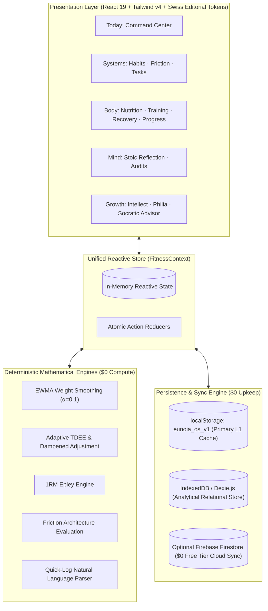

# EUNOIA — System Architecture & Design Specification (HLD & LLD)

> **Document Version**: 2.0.0  
> **Target Audience**: Senior, Mid-Senior, and Junior Agentic Engineers  
> **Core Mandate**: $0 Design & Upkeep Cost • Local-First Monolith • Token-Budget Stewardship

---

## 1. High-Level Design (HLD)

### 1.1 Architectural Philosophy: The Token-Efficient Modular Monolith
Eunoia is an athletic-grade personal life-management operating system grounded in classical Stoicism, Aristotelian Eudaimonia, Epicureanism, and behavioral science.

Because the system is designed for a single user operating local-first, the architecture is intentionally structured as a **Modular Monolith**:
1. **Token-Budget Optimization**: Distributed microservices introduce massive cognitive context bloat (Docker configs, network mocks, RPC definitions, multi-repo coordination), rapidly exhausting agent context windows. A modular monolith allows agents to reason globally with maximum token efficiency.
2. **Zero Runtime Overhead**: In-memory synchronous reactive state eliminates network latency, serialization boundaries, and cold-boot delays.
3. **Zero Financial Cost ($0 Forever)**: No hosted databases, no container clusters, no serverless billing meters.



---

### 1.2 Domain Boundaries
The monolith is strictly partitioned into 5 functional domains with well-defined contracts:

| Domain | Key Entities | Responsibilities | Storage Pattern |
| :--- | :--- | :--- | :--- |
| **Today** | `dailyIntention`, `flourishingSignals` | Daily command center, immediate priority actions, quick logging. | Aggregated projection from all domains. |
| **Systems** | `habits`, `frictionInterventions`, `tasks`, `projects`, `goals` | Behavioral architecture, 2-minute fallbacks, environmental friction, life hierarchy. | Relational hierarchy stored as document collections. |
| **Body** | `loggedFoods`, `foodLibrary`, `completedWorkouts`, `sleepRecords`, `weights` | Physical flourishing: nutrition diary, resistance training, sleep recovery, adaptive TDEE. | Time-series logs + reference catalogs. |
| **Mind** | `reflections` | Morning controllables/obstacles, evening honest audits, emotional state check-ins. | Chronological journal entries. |
| **Growth** | `learningItems`, `relationships` | Reading list, intellectual principles, Epicurean philia contact cadence, Socratic counsel. | Document collection + heuristic rule engine. |

---

### 1.3 Database Architecture: SQL vs NoSQL Decision Matrix

| Dimension | NoSQL (Current Document Store) | SQL (Relational / In-Browser SQLite WASM) | Strategic Decision for Eunoia |
| :--- | :--- | :--- | :--- |
| **Storage Engine** | Browser `localStorage` + Firebase Firestore | SQLite compiled to WASM via OPFS / IndexedDB | **Hybrid Pragmatic Architecture**: |
| **Schema Agility** | Excellent. Rapid agentic evolution without complex DDL migrations. | Rigid. Requires forward/backward SQL migration scripts (`ALTER TABLE`). | **Primary**: NoSQL document store for state agility and instant startup. |
| **Query Complexity** | In-memory filtering and map-reduce. Fast for $<100{,}000$ personal records. | Declarative SQL joins, subqueries, analytical window functions. | **Analytics**: Use in-memory relational indexing. Evaluate SQLite WASM only if record size exceeds $10\text{ MB}$. |
| **Cost** | **$0** (Free localStorage + Firebase Spark free tier: 50k reads/day). | **$0** (Local client WASM file system). | **Zero Cost Invariant strictly maintained**. |
| **Offline Performance** | Synchronous read on boot ($<5\text{ms}$). Zero serialization lag. | Asynchronous WASM bridge ($50\text{--}150\text{ms}$ cold start). | Current NoSQL provides superior mobile battery & responsiveness. |

---

### 1.4 Microservices Migration Trigger Criteria
Do **NOT** split domains into microservices unless one or more of the following explicit criteria are triggered:

1. **Heavy Isolated Background Compute**: If local computer vision food recognition or Whisper speech transcription requires dedicated GPU workers that would freeze the browser UI thread or exceed browser memory limits.
2. **Multi-User Collaboration & Synchronization**: If Eunoia transitions from a single-user personal OS to multi-tenant shared teams or real-time relational collaboration requiring operational transformation (CRDT / WebSockets).
3. **Platform Daemon Integration**: If background sensor polling (e.g. continuous Apple Watch BLE telemetry) requires a standalone native operating system daemon outside the browser sandbox.

Until an explicit trigger is met, all features **must remain inside the modular monolith**.

---

## 2. Low-Level Design (LLD)

### 2.1 State Mutation Contract
All domain state transitions are executed via synchronous, immutable updates to the centralized `FitnessState` inside [`FitnessContext.tsx`](file:///home/pedro/Desktop/Kinetic.app/src/context/FitnessContext.tsx):

```typescript
// Example: Atomic non-destructive habit toggling
const toggleHabitDate = (id: string, dateStr?: string) => {
  const targetDate = dateStr || getLocalDateString();
  setState((prev) => ({
    ...prev,
    habits: prev.habits.map((h) => {
      if (h.id !== id) return h;
      const exists = h.completedDates.includes(targetDate);
      return {
        ...h,
        completedDates: exists
          ? h.completedDates.filter((d) => d !== targetDate)
          : [...h.completedDates, targetDate],
      };
    }),
  }));
};
```

### 2.2 Non-Destructive Library Merging Algorithm (`mergeLibraries`)
When new system defaults are introduced (e.g., expanded foods or exercises), existing user modifications must never be overwritten:
- **Deduplication Key**: Composite of `id` and lowercase normalized `name`.
- **Precedence**: Existing user items take absolute precedence; new default items are appended to the catalog.

```typescript
export function mergeLibraries<T extends { id: string; name: string }>(
  userItems: T[] | undefined,
  defaultItems: T[]
): T[] {
  if (!userItems || !Array.isArray(userItems) || userItems.length === 0) {
    return [...defaultItems];
  }
  const existingIds = new Set(userItems.map((item) => item.id));
  const existingNames = new Set(userItems.map((item) => item.name.trim().toLowerCase()));

  const newDefaultsToAdd = defaultItems.filter(
    (item) => !existingIds.has(item.id) && !existingNames.has(item.name.trim().toLowerCase())
  );
  return [...userItems, ...newDefaultsToAdd];
}
```

### 2.3 Mathematical Engine Invariants

1. **EWMA Smoothing**:
   $$\text{Trend}_t = \alpha \cdot \text{Actual}_t + (1 - \alpha) \cdot \text{Trend}_{t-1} \quad (\alpha = 0.1)$$
2. **Adaptive TDEE Calculation**:
   $$\Delta E = \Delta\text{Weight (kg)} \times 7700\text{ kcal/kg}$$
   $$\text{TDEE} = \text{Average Daily Intake} - \left(\frac{\Delta E}{\text{Days Observed}}\right) \quad \text{clamped to } [1300, 4500]\text{ kcal}$$
3. **Epley 1RM Formula**:
   $$\text{1RM} = \text{Weight} \times \left(1 + \frac{\text{Reps}}{30}\right) \quad (\text{for } \text{Reps} \le 10)$$

---

## 3. The 3-Tier Agentic Operating Model

```
┌─────────────────────────────────────────────────────────────────┐
│               SENIOR AGENT (System Architecture)                │
│  - High-Level Design (HLD)                                      │
│  - Domain Boundaries, Storage Paradigm (SQL vs NoSQL)           │
│  - Token-Budget Stewardship, Monolith Preservation             │
│  - Strict $0 Cost Enforcement                                   │
└───────────────────────────────┬─────────────────────────────────┘
                                │ Produces HLD & ADRs
                                ▼
┌─────────────────────────────────────────────────────────────────┐
│             MID-SENIOR AGENT (Solution Architecture)            │
│  - Low-Level Design (LLD)                                       │
│  - Approach Evaluation & Algorithmic Selection                  │
│  - Component Contracts, Props Interfaces, Statecharts           │
│  - Evaluation Harnesses & Guardrail Specifications              │
└───────────────────────────────┬─────────────────────────────────┘
                                │ Produces LLD & Test Specifications
                                ▼
┌─────────────────────────────────────────────────────────────────┐
│              JUNIOR AGENT (Feature Implementation)              │
│  - Type-Safe React 19 / TypeScript Implementation               │
│  - Swiss Editorial Token & Tailwind Binding                     │
│  - Unit & Integration Test Authoring                            │
│  - Pre-Commit Verification Gate: Test · Lint · Build            │
│  - Atomic Commit & Instant Remote Push Protocol                 │
└─────────────────────────────────────────────────────────────────┘
```
